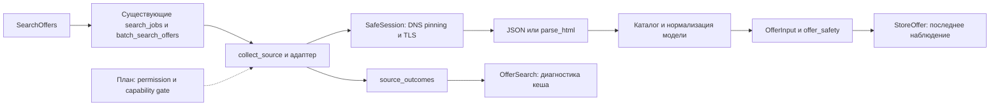

# Минимальная архитектура источников UpgradeLab

Дата: 2026-11-09. План после исследования 9 репозиториев. **Это план, не объявление всех возможностей реализованными.** Текущая ограниченная реализация — только единый диагностический outcome; остальные изменения требуют отдельных проверенных шагов. Итерация 7 A–B сохранена, C–E не подменяются этим исследованием.

## 1. Переиспользование текущего кода

SearchOffers / BuildRequest / CalculateRequest → существующие search_jobs и batch_search_offers → collect_source → store_providers / public_discovery / согласованный feed → SafeSession → parse_html/JSON → OfferInput + hardware_matching + offer_safety → upsert StoreOffer.

Без нового сервиса, Redis, NATS, MCP runtime, HTTPX или новой очереди. В workers не передавать SQLAlchemy Session. Только ограниченная параллельность существующего pool и общий monotonic deadline. Отмена останавливает будущие задачи; уже заблокированный native DNS нельзя обещать прервать принудительно. Безопасный отказ важнее fallback в обычный requests.

## 2. Целевой контракт запроса (следующее изменение)

Дополнить текущий SearchOffers полями city_id (из своего справочника), geo_mode=all/local/delivery, max_price, limit; hardware_id/category/query/sources уже есть. Все новые поля включить в search_key, search_jobs signature/idempotency, payloads сборки/апгрейда и сохранённый config. Дефолт all должен сохранять старый контракт, но «все доступные» выбирает только разрешённые интеграции.

SourceManager — существующие функции оркестрации с небольшим registry, не новая инфраструктура. Ограничить каждый источник собственным временем в общем deadline; один отказ не теряет другие результаты. Permission gate проверяется до DNS/network, независимо от выбора пользователя. Список sources сам по себе не разрешение.

## 3. ProviderAdapter и capability flags (план)

Операции: search(request), lookup_product(id/url), verify_price(offer), availability(), capabilities(). При отсутствии операции — disabled/unsupported в capabilities, а не фиктивная success.

| Flag | Что необходимо для true |
|---|---|
| search_supported | Реализованный и протестированный поиск данного типа, отдельно от разрешения/live |
| product_lookup_supported | Чтение конкретной товарной карточки с identity check |
| regional_search_supported | Документированная передача региона и проверенные соответствия; сейчас не подтверждено ни у одного внешнего |
| availability_supported | Разбор фактического статуса SKU с evidence; нельзя считать разметку цены наличием |
| delivery_supported | Подтверждение доставки конкретного SKU в конкретный город и условий |
| official_api_supported | Именно официальный подключённый API с понятным scope, не JSON страницы |
| browser_required | Для данного рабочего пути нужен browser; такое capability сейчас ведёт к disabled |
| access_authorized | Подтверждены право получения/использования и необходимые доступы; по умолчанию false для внешних |

Не выставлять access_authorized по наличию адаптера, MIT, feed URL, cookies или успешного GET. Avito после отказа остаётся неразрешённым. Возможности (технически поддержано), права и здоровье (last attempt/live not tested) — три отдельных измерения.

## 4. Extractor, normalizer, validator

Сохранять SafeSession с HTTPS/443, DNS all-A/AAAA, numeric-IP pinning, исходными SNI/Host/cert, revalidation каждого redirect, no env proxy, caps и watchdog. Небезопасный Chromium/CDP не включать. Transport выдаёт ограниченный bytes + charset/content-type/status/URL; не хранить cookies/tokens/raw headers в диагностике.

Выделять extractor только когда появляется второй проверенный формат. Предпочтительные форматы:
- импортированный JSON/официальный JSON API → schema validation;
- XML/YML → ограниченный безопасный XML без внешних entities/network;
- CSV → явные encoding/delimiter/колонки/Decimal/валюта;
- Excel → сначала документированный xlsx и лимиты zip/размера/листов, без макросов; новый dependency только при необходимости;
- JSON-LD → Product/Offer и canonical identity, stock отдельно;
- HTML → source-specific DOM scopes; не цена рекомендаций/рассрочки/карты без условий.

В этой поставке XML/CSV/Excel-конвертеры не реализуются, их тесты нельзя объявлять успешными. Нужны образцы с разрешением, schema version и происхождением. Внешний source не обязан поддерживать все форматы.

Normalizer переиспользует каталог/сигнатуры и vram/RAM checks. Отдельно manufacturer/model/revision/variant/condition/характеристики. Не стирать Ti/Super/G/VRAM/mobile при очистке текста. Неуверенная модель остаётся несопоставленной и не получает финансовый ID автоматически.

Validator: positive finite price, RUB/RUR, source/category/condition, URL allowlist, observation UTC, current verification UTC, quality, city/availability evidence. Missing/invalid price не превращается в 0. Ожидаемая выручка не становится подтверждённой продажей.

## 5. Единый диагностический контракт — выбранная реализация

**Одна задача:** типизированный исход получения предложений без замены transport/extractors/optimizer.

Отдельный outcome дополняет legacy status (public_page/feed/unavailable/timeout/disabled). Legacy status продолжает означать прежнее происхождение/состояние; это сохраняет сборки и UI-потребителей. Поиск возвращает source_outcomes и сохраняет outcome в существующем OfferSearch.statuses, без новой таблицы.

Vocabulary: success, no_results, partial, blocked, rate_limited, timeout, network_error, parse_error, parser_drift, unauthorized, access_not_permitted, unavailable, disabled, not_tested. Не все коды возникают в текущих адаптерах: access_not_permitted требует permission gate; not_tested относится к отсутствию наблюдений, а не нулю ошибок. HTTP 401/403/429, тайм-аут, parse failure имеют разные причины. No_results только при достоверно пустом структурированном результате; не любой пустой HTML.

Поле elapsed_ms — monotonic время сетевой работы/извлечения данного источника; cached outcome не является новым live-запросом. Исключённый по deadline источник имеет attempted=false. Кеширование поиска не обновляет checked_at подтверждения цены.

parser_drift означает «документ не удовлетворяет ожидаемому контракту извлечения», а не доказанную дату изменения сайта. Возможны JS-shell/изменение формата/отсутствие читаемых полей; это не no_results и не гарантия неисправности live-адаптера.

## 6. История (план, без миграции сейчас)

В UpgradeLab уже есть StoreOffer latest, attributes.price_verification/last_verified_price, OfferSearch попытки и SavedBuild immutable JSON + price_snapshot/price_review. Отдельного полного append-only журнала предложений нет — не выдавать last_verified_price за него и не создавать дубликат существующей таблицы.

После отдельного решения можно добавить OfferObservation(source, external_id/url, observed_at, price/currency/condition/availability, origin, evidence_version) и SourceAttempt/outcome или расширение текущих statuses. first_seen — min достоверного наблюдения, last_seen — max, last_verified — отдельное доказательство с TTL. Не переносить правило «цена без изменений → свежее подтверждение» без нового чтения. Soft deletion/closed только по достоверному карточному/официальному статусу; отсутствие в неполной пагинации не доказательство удаления. SavedBuild.data не переписывается; purge runtime history не удаляет исторический снимок.

## 7. География и внутренняя биржа (план)

Использовать app/data/cities.json со стабильными UpgradeLab ID, без вымышленных vendor codes. location_unknown — дефолт внешних старых записей. Seller city, физический stock, доставка и заявление пользователя — разные поля/доказательства.

local принимает только подтверждённую географию выбранного города; delivery дополнительно требует доставки данного SKU в этот город. Стоимость товара + известная доставка участвуют в бюджете; неизвестная стоимость явно отдельна и не даёт окончательную сумму с доставкой.

Внутренний adapter читает Listing/ListingOwner/Hardware напрямую из БД, без HTTP к себе. Sold/withdrawn/broken и устаревшее/отсутствующее заявление продавца исключаются по отдельной политике. Seller-declared не повышается до магазинного verified или complete только из-за существования строки. Изменение цены/города/модели/статуса инвалидирует соответствующий keyed cache; исторические сохранения сохраняют исходное описание.

## 8. Тестовая стратегия

Ни сторонние тесты, ни live-check scripts не запускать. Собственные synthetic fixtures, mock SafeSession/DNS/socket. Для текущей одной задачи: success/empty-feed/block/rate-limit/401/timeout/network/drift/parse, HTML CAPTCHA, неизвестный документ, неоднозначная цена, старый кеш без outcome, независимые параллельные источники, частичный результат, expired deadline, исходные checked_at и legacy статусы, persisted outcome и отсутствие секретов в новых сообщениях.

После получения разрешённых образцов отдельно: JSON/XML/CSV/xlsx/JSON-LD/HTML, плохая кодировка, недостающая цена, duplicates/model/geo mismatch, changed price/deleted listing, cancellation, delivery totals и complete/draft/partial. Пока эти форматы не реализованы, это план, не результаты тестирования.

## 9. Метрики: знаменатели и происхождение

Разделять mode=fixture и mode=production; число реальных запросов отдельно. При denominator=0 возвращать null/not_tested, не 0%/100%.

| Метрика | Расчёт |
|---|---|
| Успешные запросы | success / attempted noncached requests; partial считать отдельно |
| Результаты с ценой | positive valid price rows / extracted rows до фильтра; нужны счётчики до/после |
| Подтверждённые цены | fresh verified rows / eligible priced rows; считать на момент отчёта по UTC |
| Модели | однозначные validated catalog matches / eligible component rows |
| Среднее время | sum elapsed_ms / measured noncached attempted sources; timeout также учитывается |
| Ошибки извлечения | parse_error + parser_drift по попыткам, отдельно от network/block |
| Устаревшие предложения | rows failing observation TTL / observed rows; проверка в текущем времени |
| Подтверждённая география | eligible rows with current city evidence / eligible rows |
| Полные/частичные сборки | complete / finished assemble jobs; partial / finished assemble jobs; draft отдельно |

Текущие OfferSearch хранят последний кешируемый результат, не все попытки. Поэтому нельзя восстановить из них достоверную lifetime success rate. elapsed_ms/outcome — основа диагностики, не полностью реализованный production-monitoring. Таблицу статистики добавлять только с требованиями retention/privacy; не копировать Redis/monitor subsystem Grex ради счётчика.

## 10. Рекомендуемый порядок после этой задачи

Сначала централизованный permission/capability gate и один согласованный JSON/CSV feed с безопасными fixtures; затем geo/cache-key/internal-market adapter и сквозные городские сборки. История/остальные форматы — отдельные минимальные изменения. Не включать все 12 площадок или private API на основании этого исследования. Коммит/публикация только после разрешения владельца.

## 11. Итог ограниченной реализации

Реализована ровно одна задача — диагностический контракт источников:
- source_outcomes.py: vocabulary, SourceFailure, monotonic elapsed/result_count, совместимое представление старых записей.
- store_providers: известные HTTP/CAPTCHA/no-readable-document/ambiguous-price/NIX failures получают тип; fetch и selectors работают прежним способом.
- collect_source/persist_search: outcome и данные попытки сохраняются в существующем JSON OfferSearch, без миграции.
- search_offers и batch_search_offers возвращают source_outcomes, cached явно отделён; /offers/status дополняет last_search.outcome.
- Произвольный legacy RuntimeError не отражает сырые URL/секреты пользователю; остаётся безопасный numeric HTTP hint или общий текст. Тексты ошибок схемы feed фиксированы и не включают тело/token.
- SourceFailure остаётся RuntimeError для существующих потребителей. Legacy status/origin не заменён outcome; цена не получает verified из-за success.
- Старый успешный кеш без typed evidence получает outcome=not_tested (тип не восстановим), а не новую успешную попытку; старые ошибки unavailable остаются unavailable. Timestamps не обновляются.

Не реализованы этой задачей registry/capability API, permission gate, новые extractors/XML/CSV/Excel, журнал истории, городской финансовый адаптер, интеграции, production telemetry. Все они остаются планом. Исходные таблицы, source access flags, cookies, transport, TTL, FPS и совместимость не изменены.

Вложенные HTTP-discovery ошибки пока могут оставаться legacy unavailable; partial определён, если есть строки и явная error-деталь. Parser drift не устанавливает конкретную причину без fixtures сайта. Cooldown — blocked с attempted=false, это не новый сетевой 403/429. Source count относится к строкам адаптера до catalog/quality/available filters, не к финальному числу финансово пригодных товаров.

Проверки: 23 новых локальных backend-теста, в том числе 401/403/429/439/503, CAPTCHA, timeout/network_error, empty/invalid feed, неизвестный документ, отсутствующая/неверная цена, неоднозначная карточка, partial result, legacy cache, UTC, параллельность, отмена и скрытие raw ошибок. Изначальные 15 тестов воспроизводили отсутствие контракта; отдельный тест утечки RuntimeError падал до исправления. Ни сторонний test suite, ни магазинные live-проверки не запускались.

Полная регрессия: 339 обнаружено, 337 успешно, 2 пропущены при discover; standalone smoke/recovery успешны. Frontend 47/47. Интерфейс не менялся; используется прежнее поле message, новые поля доступны клиенту API. git diff --check успешен. Ноль live-запросов не означает 0% отказов или 100% успеха.

Файлы этой поставки: .gitignore; backend/app/services/source_outcomes.py (новый), offers.py, store_providers.py; backend/app/api/offers.py; backend/tests/test_source_outcomes.py (новый); docs/PARSER_RESEARCH.md, SOURCE_ARCHITECTURE_PLAN.md, parser_research_manifest.json (новые), ARCHITECTURE.md, TECHNICAL_AUDIT.md, TODO.md, CHANGELOG_DEV.md и README.md. Источники .research не входят в приложение и Git.

Предлагаемый коммит: feat: add typed provider outcomes after parser research. Коммит и публикация не выполнялись.

## Схема ролей целевого слоя

Роли частично совмещены в существующих функциях; provider registry и permission gate пока остаются планом.

